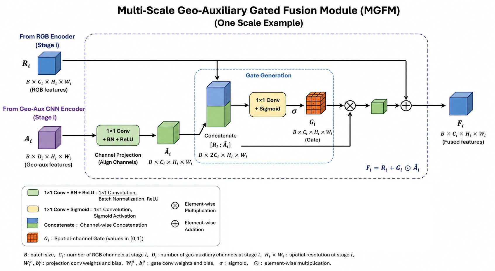

# Malawi Multimodal Landslide Dataset and Geo-Auxiliary SegFormer

This repository contains the reproducibility code associated with a multimodal Earth-observation framework for landslide mapping in Malawi following Cyclone Freddy 2023. It provides utilities for reconstructing the PlanetScope-derived optical patches, training the RGB–VV-coherence dual-branch SegFormer model, and performing independent test inference.

> **Repository status:** The Malawi multimodal landslide dataset is publicly available on Zenodo: https://doi.org/10.5281/zenodo.22877238. The associated manuscript has been accepted for publication, and its DOI will be added once available.

## Overview

The dataset combines optical, SAR, SAR-coherence, topographic, hydrological, and landslide-label information on a common **128 × 128 pixel grid at 3 m spatial resolution**. The model implementation included in this repository uses **RGB imagery together with pre-event and post-event VV coherence**.

The open dataset is organized into independent `train`, `val`, and `test` subsets. The current dataset contains **1,536 training patches, 171 validation patches, and 382 test patches**. Each split contains the same set of modality folders.

### Dataset examples


The dataset contains the following layers:

- RGB
- NIR
- NDVI
- VV coherence — pre-event
- VV coherence — post-event
- VH coherence — pre-event
- VH coherence — post-event
- VV — pre-event
- VH — pre-event
- VV — post-event acquisition 1
- VH — post-event acquisition 1
- VV — post-event acquisition 2
- VH — post-event acquisition 2
- DEM
- Slope
- Aspect
- Curvature
- Flow direction
- Flow accumulation
- Landslide mask

## Model architecture

The landslide-segmentation model is a dual-branch architecture built around a pretrained **SegFormer MiT-B2** RGB encoder. A residual CNN processes the geo-auxiliary input, and multi-scale gated fusion integrates the auxiliary features with the four SegFormer encoder stages. An auxiliary prior head provides additional training supervision.


### Multi-Scale Geo-Auxiliary Gated Fusion Module

At each encoder stage, the geo-auxiliary feature map is projected to the corresponding RGB feature dimension. The projected auxiliary features and RGB features are used to generate a spatial-channel gate, which controls the contribution of the auxiliary information before residual fusion with the RGB representation.



For the training configuration provided in this repository, the auxiliary branch receives:

```text
VV_COH_pre
VV_COH_post
```

The loss combines cross-entropy, Tversky loss, auxiliary coherence-prior supervision, and a consistency term.

## Repository structure

```text
.
├── README.md
├── requirements.txt
├── notebooks/
│   ├── Malawi_PlanetScope_Exact_Patch_Rebuilder_v2.ipynb
│   ├── Malawi_SegFormer_RGB_VVCOH_Training_v3_original_architecture.ipynb
│   └── Malawi_SegFormer_RGB_VVCOH_Inference_v3_original_architecture.ipynb
├── metadata/
│   └── PlanetScope_post_source_per_patch.csv
└── figures/
    ├── dataset_examples.png
    ├── model_architecture.png
    └── mgfm_module.png
```

## Dataset structure

The dataset itself is distributed separately from the GitHub repository. After download/reconstruction, the expected structure is:

```text
DL Malawi Dataset/
├── train/
│   ├── Aspect_degree/
│   ├── Curvature/
│   ├── DEM/
│   ├── Flow_accumulation/
│   ├── Flow_direction/
│   ├── Mask/
│   ├── NDVI/
│   ├── NIR/
│   ├── RGB/
│   ├── Slope_degree/
│   ├── VH_COH_post/
│   ├── VH_COH_pre/
│   ├── VH_post1/
│   ├── VH_post2/
│   ├── VH_pre/
│   ├── VV_COH_post/
│   ├── VV_COH_pre/
│   ├── VV_post1/
│   ├── VV_post2/
│   └── VV_pre/
├── val/
│   └── [same modality folders]
└── test/
    └── [same modality folders]
```

## Notebooks

### 1. PlanetScope exact-patch reconstruction

`Malawi_PlanetScope_Exact_Patch_Rebuilder.ipynb`

PlanetScope-derived **RGB, NIR, and NDVI are not redistributed directly** with the open dataset. The reconstruction notebook allows users with their own authorized Planet account and imagery access to rebuild the required optical patches.

For each manifest entry, the notebook:

1. uses the exact 128 × 128 patch footprint;
2. converts the EPSG:32736 footprint to WGS84;
3. identifies Planet `PSScene` items intersecting the required footprint and acquisition date;
4. requests only the required area using the Planet Orders API Clip tool;
5. composites multiple verified source items when necessary;
6. reprojects the delivered Surface Reflectance data to the exact dataset grid;
7. reconstructs RGB, NIR, and NDVI GeoTIFFs.

#### Required metadata

The reconstruction workflow requires the accompanying `PlanetScope_post_source_per_patch.csv` file provided in this repository. Users should download both:

- `Malawi_PlanetScope_Exact_Patch_Rebuilder.ipynb`
- `PlanetScope_post_source_per_patch.csv`

and save them locally. Before running the notebook, the path to `PlanetScope_post_source_per_patch.csv` must be specified in the notebook configuration cell.

The CSV contains the patch-level metadata required by the reconstruction workflow. PlanetScope imagery itself is **not distributed through this repository** and must be accessed through the user's own authorized Planet account.

The RGB and NIR reconstruction uses the original per-band 2nd–98th percentile normalization applied on valid pixels.

**Important:** users must provide their own Planet API key and must have the necessary Planet imagery permissions. No Planet API key should ever be committed to this repository.

### 2. Model training

`Malawi_SegFormer_RGB_VV_COH_Training.ipynb`

The training notebook uses the `train` and `val` subsets separately. The independent test set is not accessed during model development.

Model inputs:

```text
RGB
VV_COH_pre
VV_COH_post
Mask
```

Training augmentation reproduces the four-orientation experiment:

```text
0°, 90°, 180°, 270°
```

The same rotation is applied to RGB, both coherence layers, and the landslide mask. Therefore, the 1,536 original training patches produce **6,144 training samples**. The 171 validation patches remain unaugmented.

The best model is selected using validation **Recall** and is saved for the independent inference workflow.

### 3. Independent test inference

`Malawi_SegFormer_RGB_VV_COH_Inference.ipynb`

The inference notebook restores the trained dual-branch architecture and evaluates the independent `test` subset. No rotation augmentation or test-time augmentation is applied.

The notebook exports:

- georeferenced binary landslide predictions;
- landslide probability GeoTIFFs;
- per-patch evaluation results;
- aggregate independent-test metrics.

## Installation

A Python environment with CUDA-enabled PyTorch is recommended for model training.

```bash
pip install -r requirements.txt
```

PyTorch/CUDA installation can be platform-specific. If GPU training is required, install the appropriate PyTorch build for the CUDA version available on the system before installing the remaining dependencies.

The notebooks explicitly use the `safetensors` version of the pretrained MiT-B2 weights. The image processor is loaded with `use_fast=False` to preserve the preprocessing behavior used in the experiment.

## Usage

### Training

Open the training notebook and set:

```python
TRAIN_DIR = Path(r".../DL Malawi Dataset/train")
VAL_DIR = Path(r".../DL Malawi Dataset/val")
OUTPUT_DIR = Path(r".../model_output")
```

Run the notebook sequentially to train the model and save the selected checkpoint.

### Inference

Open the inference notebook and set:

```python
TEST_DIR = Path(r".../DL Malawi Dataset/test")
MODEL_DIR = Path(r".../model_output/best_model")
OUTPUT_DIR = Path(r".../inference_output")
```

### PlanetScope reconstruction

Open the PlanetScope reconstruction notebook and set the manifest path and reconstruction output directory. The Planet API key is requested securely at runtime and is not intended to be stored in the notebook.

## Data availability

The Malawi Multimodal Earth Observation Dataset for Landslide Mapping Following Cyclone Freddy 2023 is publicly available on Zenodo.

Dataset DOI: https://doi.org/10.5281/zenodo.22877238

Zenodo repository: https://zenodo.org/records/22877238

The dataset is distributed in three archives corresponding to the training, validation, and independent test subsets:

Malawi_Multimodal_Landslide_train.rar — 1,536 patches

Malawi_Multimodal_Landslide_val.rar — 171 patches

Malawi_Multimodal_Landslide_test.rar — 382 patches

The archives contain the redistributable Sentinel-1 SAR, SAR-coherence, topographic, hydrological, and landslide ground-truth layers.

PlanetScope-derived RGB, NIR, and NDVI imagery is not redistributed due to Planet licensing restrictions. Authorized users can reconstruct these optical layers using the Malawi_PlanetScope_Exact_Patch_Rebuilder.ipynb notebook and the accompanying PlanetScope_post_source_per_patch.csv metadata file provided in this GitHub repository, using their own authorized Planet account and imagery access.

**Dataset DOI:** *to be added*

## Citation

If you use this dataset or the associated code in your research, please cite the published article:

Published article: https://doi.org/10.3390/rs18213722 

## License

The dataset distributed through Zenodo is released under the Creative Commons Attribution 4.0 International (CC BY 4.0) license.

Dataset license: https://creativecommons.org/licenses/by/4.0/

PlanetScope imagery is not redistributed. Access to and use of PlanetScope imagery remain subject to Planet's applicable licensing terms and the user's authorized access permissions.

The dataset license does not automatically establish a license for the source code in this GitHub repository. Software licensing information will be provided separately.

## Contact

**Abdelkader Riche**  
abdelkader.riche@unifi.it
University of Florence (UNIFI)
